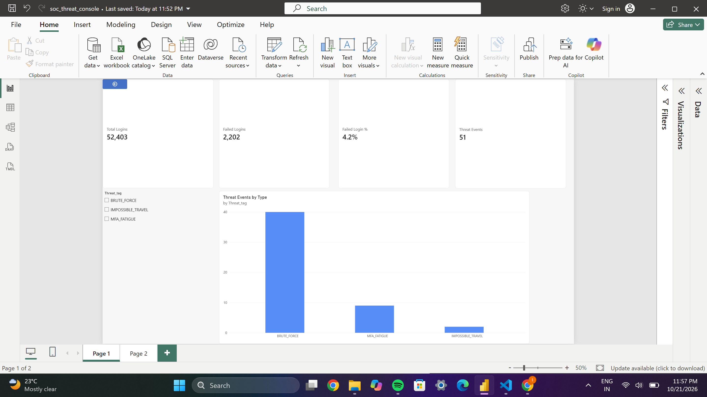
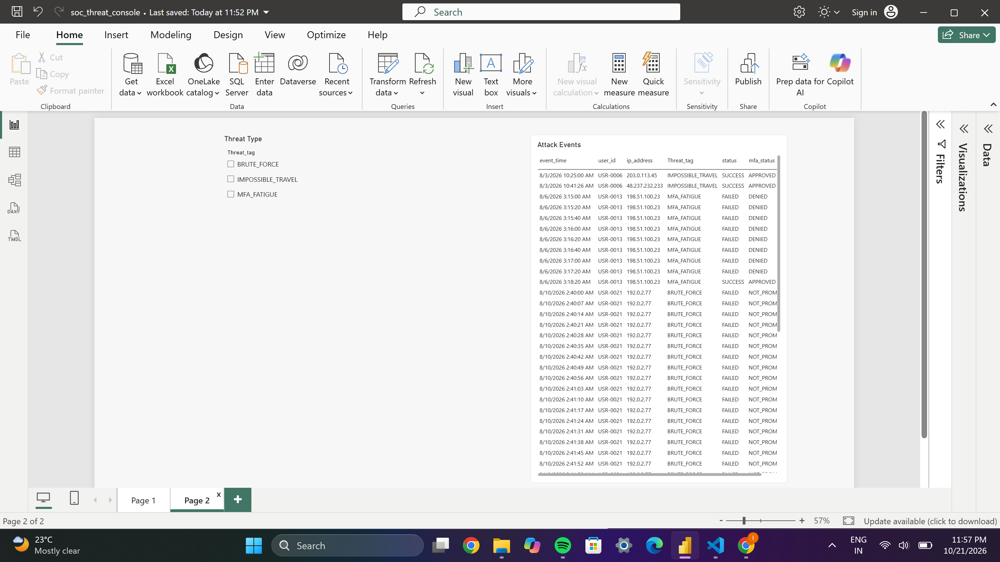

# ThreatLens

A mini version of what a Security Operations Center (SOC) team uses to catch hacked accounts. It generates fake login data, stores it in PostgreSQL, and shows suspicious activity in a Power BI dashboard.

## What it detects

| Threat | What it means |
|---|---|
| BRUTE_FORCE | Many failed password attempts against an account |
| MFA_FATIGUE | An attacker spams approval prompts until the user taps "approve" |
| IMPOSSIBLE_TRAVEL | Logins from locations too far apart to travel between in the time given |

## How it works

1. **Python** generates synthetic data: 150 users and about 52,400 login events, written to CSV files.
2. **PostgreSQL** stores the data in linked tables: `dim_users`, `dim_devices`, `dim_locations` and `fact_auth_events`, plus a view that adds a `Threat_tag` to each event.
3. **Power BI** reads the view and shows two pages.

## Dashboard

**Overview**
- Total Logins: 52,403
- Failed Logins: 2,202
- Failed Login %: 4.2%
- Threat Events: 51
- Bar chart of threat events by type (BRUTE_FORCE 40, MFA_FATIGUE 9, IMPOSSIBLE_TRAVEL 2)

**Attack Details**
- Table of every flagged event: time, user, IP address, threat type, status and MFA result
- Slicer to filter by threat type

## Screenshots




## Tools used

Python (pandas, psycopg2), PostgreSQL, pgAdmin, Power BI Desktop

## Project structure

```
siem-project/
  sql/   01_schema_setup.sql        creates the tables
  data/  generate_logs.py           makes the fake data (CSV files)
         load_dim_users.py          loads users into PostgreSQL
         load_fact_events.py        loads login events into PostgreSQL
         load_answer_key.py         loads the list of planted attacks
  bi/    soc_threat_console.pbix    Power BI dashboard
  screenshots/                      dashboard pictures
```

## Run it yourself

1. Create a PostgreSQL database and run `sql/01_schema_setup.sql`.
2. Run `data/generate_logs.py` to create the CSV files.
3. Run the three `load_*.py` scripts. Each one asks for your PostgreSQL password when you run it, so no password is stored in the code.
4. Open `bi/soc_threat_console.pbix` in Power BI Desktop and refresh the data.

## Notes

All data is fake. IP addresses come from reserved documentation ranges and emails use `example.com`.
